

  <strong>English</strong> &nbsp;|&nbsp; <a href="./README.zh-CN.md">简体中文</a>

  <a href="https://www.we-signage.com">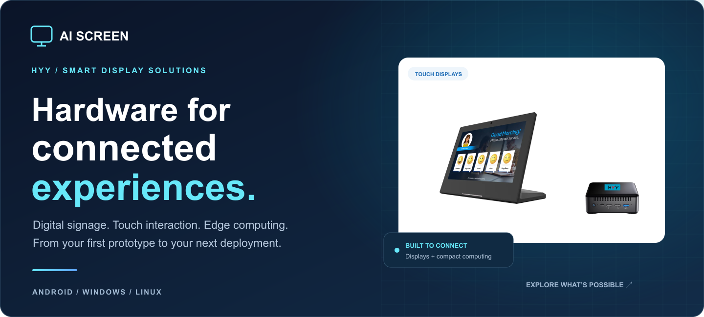</a>

  
  
  

  <a href="#products">PRODUCTS</a> &nbsp; / &nbsp;
  <a href="#platform">PLATFORM</a> &nbsp; / &nbsp;
  <a href="#resources">DEVELOPER RESOURCES</a> &nbsp; / &nbsp;
  <a href="#deliveries">DELIVERIES</a> &nbsp; / &nbsp;
  <a href="#contact">CONTACT</a>

  

## 01 / Find your next display

**Six product families. A world of applications.** Explore hardware for your next installation, integration or product idea.

  <a href="./Documents/Products/L-type-AIO-Display/">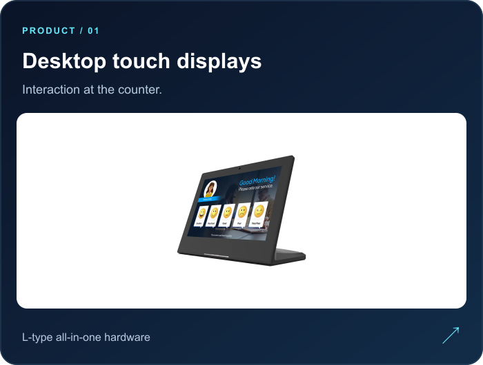</a>
  <a href="./Documents/Products/raspberry-pi/">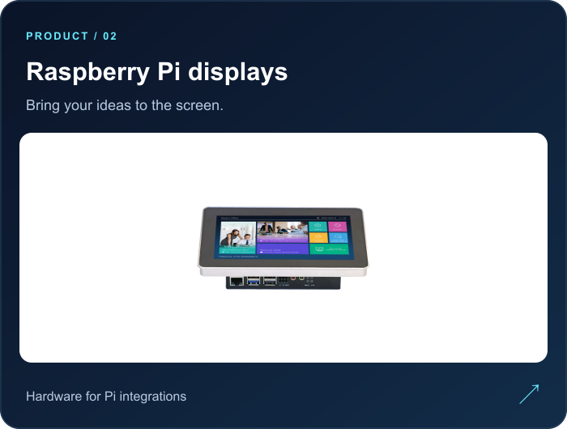</a>

  <a href="./Documents/Products/Commercial-Display/">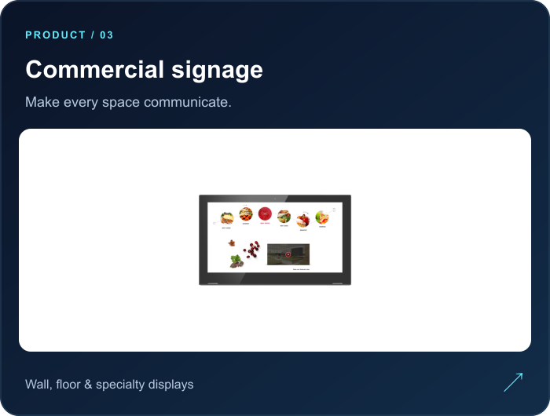</a>
  <a href="./Documents/Products/Medical-Health-Display/">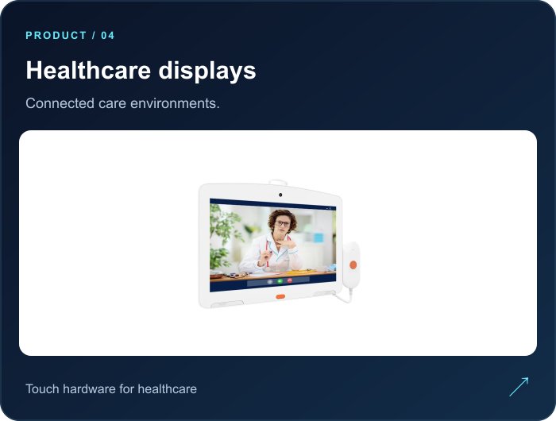</a>

  <a href="./Documents/Products/Meeting-room-Display/">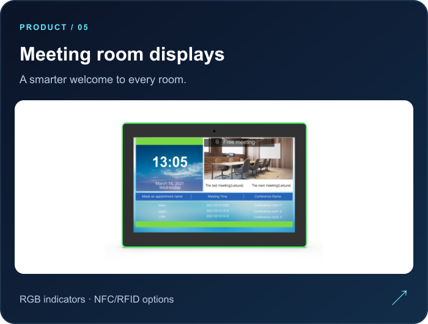</a>
  <a href="./Documents/Products/box/">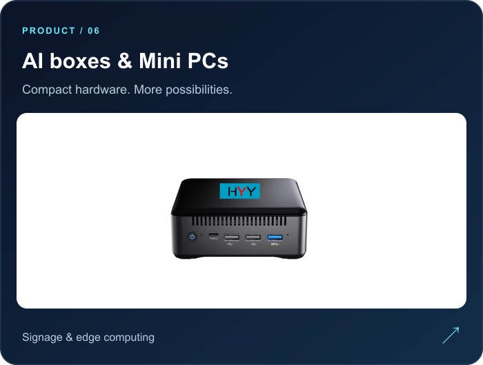</a>

  <a href="./Documents/Products/Customized-Project/"><strong>Looking for something specific? Explore customized projects →</strong></a>

 

## 02 / Built around your application

HYY brings over a decade of experience in digital signage and human-computer interaction. Our team works across Android, Windows and Linux to help you select the hardware for your project.

<table>
  <tr>
    <td valign="top" width="50%">
      <h3>One portfolio. Multiple platforms.</h3>
      
Android, Windows and Linux solutions. Rockchip options include RK3566, RK3568 and RK3588.

    </td>
    <td valign="top" width="50%">
      <h3>From counters to public spaces.</h3>
      
Desktop, wall-mounted and floor-standing displays, with compact AI boxes and Mini PCs.

    </td>
  </tr>
  <tr>
    <td valign="top">
      <h3>Hardware with a purpose.</h3>
      
For schools, hotels, restaurants, retail, banks, healthcare and charging stations.

    </td>
    <td valign="top">
      <h3>Ready for your integration.</h3>
      
Device APIs, management guides and project examples to help you get started.

    </td>
  </tr>
</table>

For GMS, CE and battery certification requirements, contact us to confirm availability for your selected model.

 

## 03 / From hardware to integration

Guides, APIs and product demos for your next step.

| Resource | Start here |
| :--- | :--- |
| Product demonstrations | [Watch the HYY YouTube channel](https://www.youtube.com/@digitalsignagehyy9377) |
| Boot logo customization | [Boot logo replacement guide](https://github.com/industrialtablet/AI-Screen/wiki/BootLogo-Replacement-by-yourself) |
| Device management | [HYY MDM solutions guide · PDF](./Documents/wiki/img-replace-logo/MDM.pdf) |
| Remote display control | [Remote control guide · PDF](./Documents/wiki/other/remote%20%20control%20display-9.5.pdf) |
| Android development | [HYY RK3566 Android framework API library](https://github.com/arlenhe/HYY_rk3566_api) |
| Meeting room integration | [Meeting room signage API · Chinese PDF](./Documents/Applications/api/API_for_Meeting_room_digital_signage_instruction_Chinese_version.pdf) |

 

## 04 / Beyond the product page

Real products. Real deliveries. Explore a selection from our gallery.

<table>
  <tr>
    <td align="center" width="33%">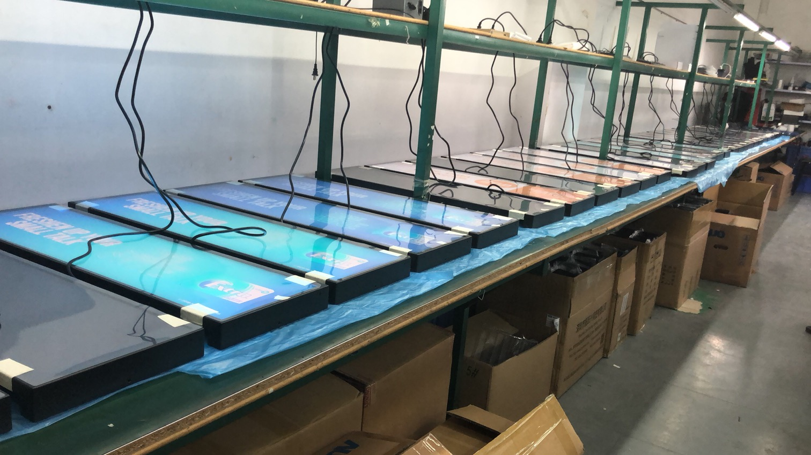</td>
    <td align="center" width="33%">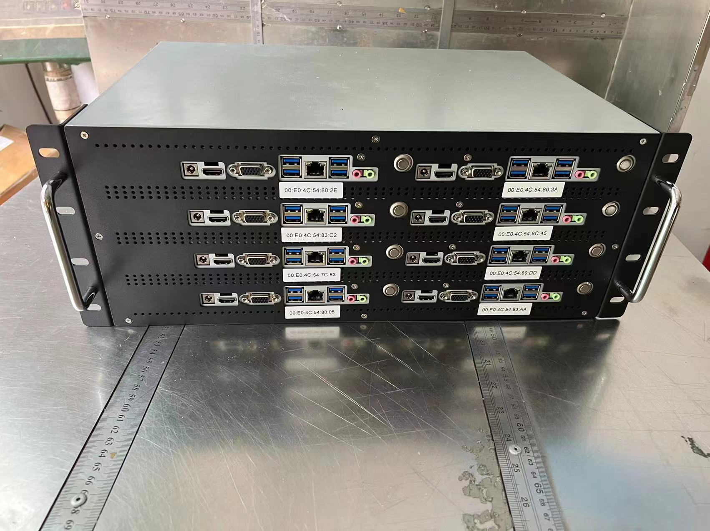</td>
    <td align="center" width="33%">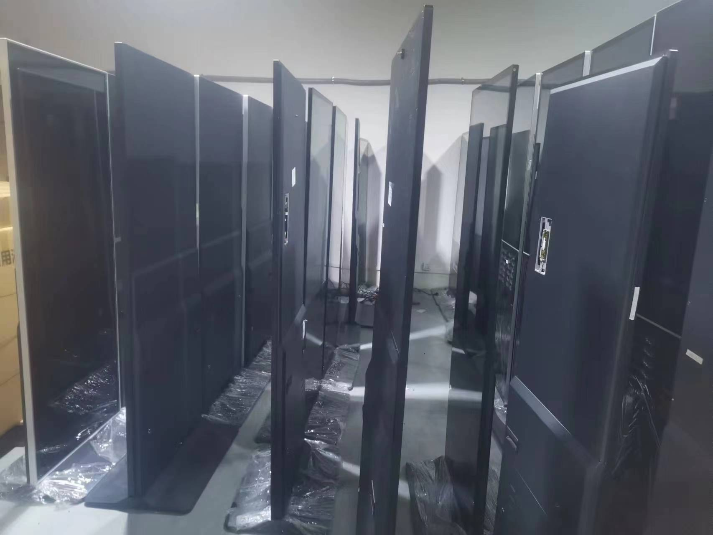</td>
  </tr>
</table>

  
<strong>View more product &amp; delivery photos</strong>

   
  <table>
    <tr>
      <td align="center" width="33%">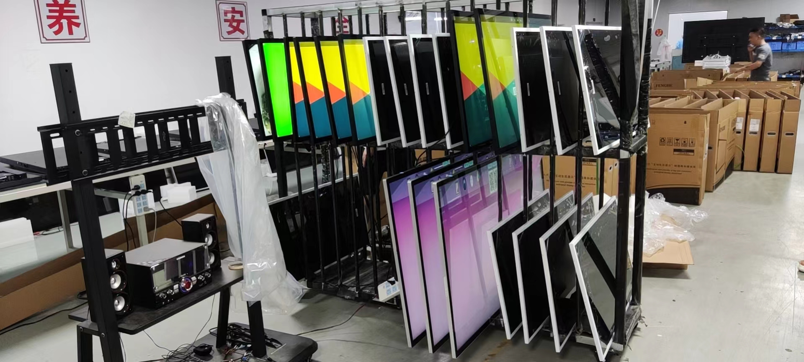</td>
      <td align="center" width="33%"></td>
      <td align="center" width="33%">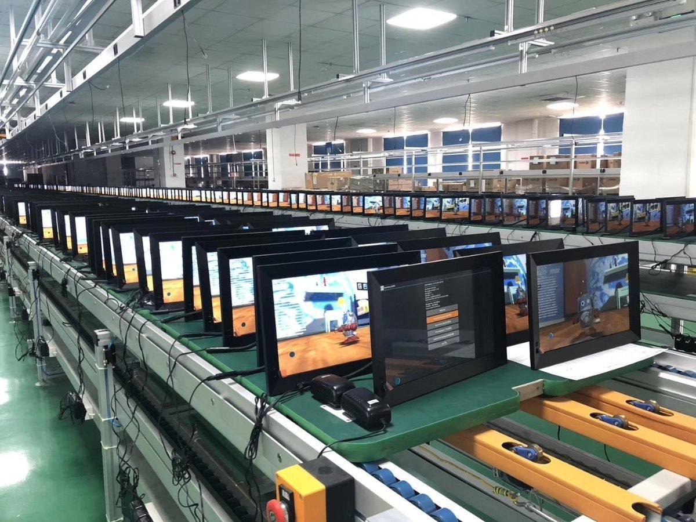</td>
    </tr>
    <tr>
      <td align="center" width="33%"></td>
      <td align="center" width="33%">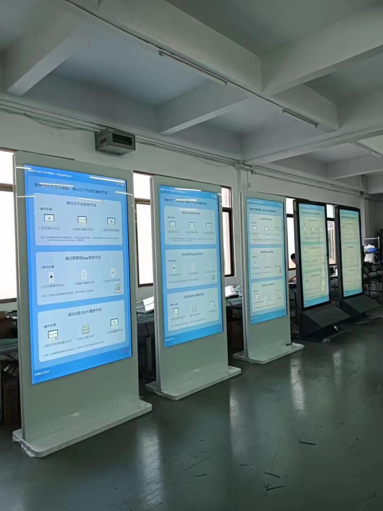</td>
      <td align="center" width="33%"></td>
    </tr>
    <tr>
      <td align="center" width="33%"></td>
      <td align="center" width="33%"></td>
      <td align="center" width="33%"></td>
    </tr>
  </table>

  
<strong>Meet the HYY team · Android / Linux / Windows</strong>

   

<table>
  <tr>
    <td align="center" valign="top" width="20%">
       
      <strong>Dennis</strong> CEO
    </td>
    <td align="center" valign="top" width="20%">
       
      <strong>Arlen</strong> CMO
    </td>
    <td align="center" valign="top" width="20%">
       
      <strong>Zhang</strong> CFO
    </td>
    <td align="center" valign="top" width="20%">
       
      <strong>Owen</strong> CTO
    </td>
    <td align="center" valign="top" width="20%">
       
      <strong>Kevin</strong> CTO
    </td>
  </tr>
</table>

 

  <a href="mailto:dennis@we-signage.com">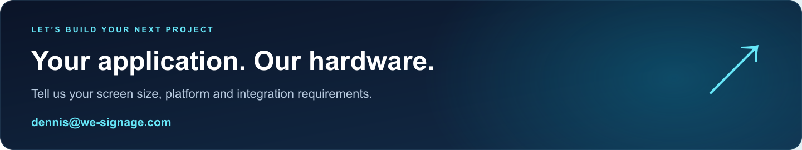</a>

  <a href="mailto:dennis@we-signage.com"><strong>EMAIL OUR TEAM ↗</strong></a> &nbsp; / &nbsp;
  <a href="https://wa.me/8617388781631"><strong>WHATSAPP ↗</strong></a> &nbsp; / &nbsp;
  <a href="https://www.eellnet.com"><strong>VISIT HYY ↗</strong></a>

  
<strong>All contact channels &amp; location</strong>

| Channel | Details |
| :--- | :--- |
| Email | [dennis@we-signage.com](mailto:dennis@we-signage.com) |
| WhatsApp / Mobile | [+86 173 8878 1631](https://wa.me/8617388781631) |
| WeChat | +86 133 4990 9990 |
| Websites | [eellnet.com](https://www.eellnet.com) ｜ [hyysz.com](https://www.hyysz.com) ｜ [we-signage.com](https://www.we-signage.com) |
| Product marketplace | [HYY on Made-in-China](https://we-signage.en.made-in-china.com/) |
| LinkedIn | [Connect with WeSignage](https://www.linkedin.com/in/wesignage/) |
| YouTube | [Product videos & tutorials](https://www.youtube.com/@digitalsignagehyy9377) |

  
View our location map

   
  <a href="https://www.we-signage.com">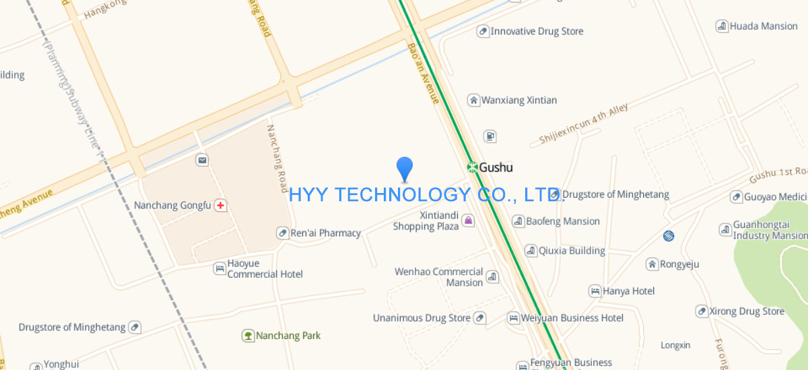</a>

---

  <strong>AI SCREEN / HYY</strong> 
  AI-Powered Human-Computer Interaction  
  <a href="#top">BACK TO TOP ↑</a>

