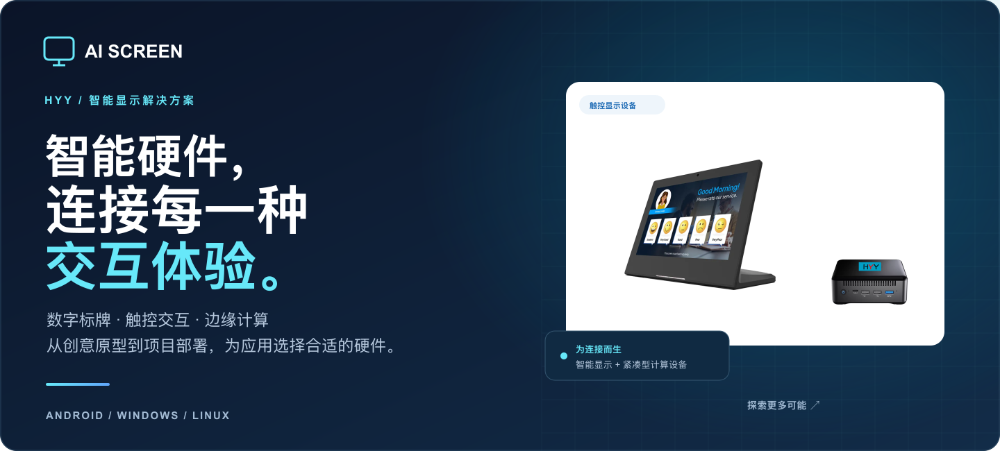
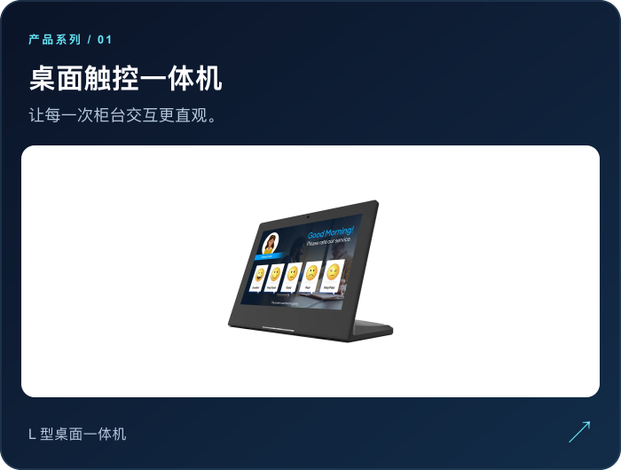
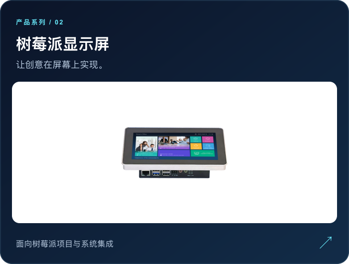
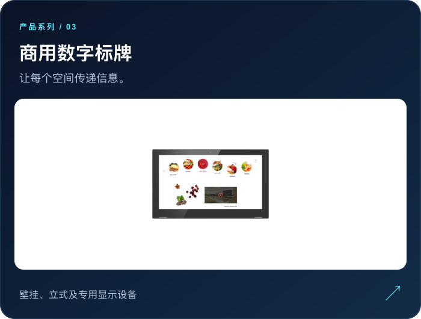
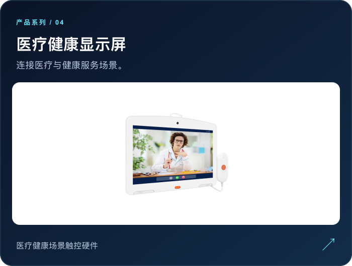
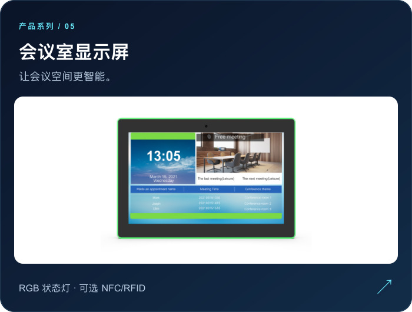
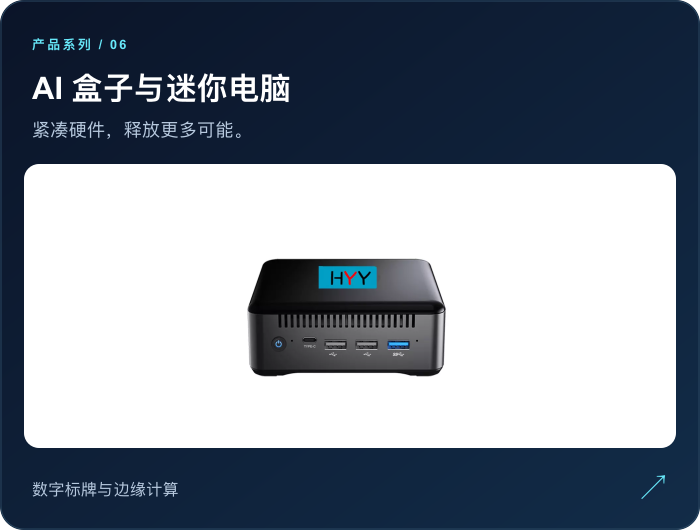
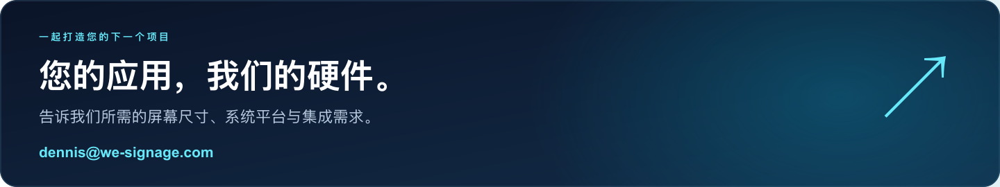

  <a href="./README.md">English</a> &nbsp;|&nbsp; <strong>简体中文</strong>

  

  
  
  

  <a href="#products">产品系列</a> &nbsp; / &nbsp;
  <a href="#platform">系统与应用</a> &nbsp; / &nbsp;
  <a href="#resources">开发资源</a> &nbsp; / &nbsp;
  <a href="#deliveries">交付展示</a> &nbsp; / &nbsp;
  <a href="#contact">联系我们</a>

  

## 01 / 探索适合您的显示设备

**六大产品系列，覆盖多种应用场景。** 为您的下一次部署、系统集成或产品创意找到合适的硬件。

  
  

  
  

  
  

  <a href="./Documents/Products/Customized-Project/"><strong>有特殊需求？查看定制项目 →</strong></a>

 

## 02 / 围绕您的应用，选择合适的硬件

HYY 拥有超过十年的数字标牌与人机交互行业经验。我们的团队覆盖 Android、Windows 和 Linux 平台，帮助您为项目选择合适的硬件。

<table>
  <tr>
    <td valign="top" width="50%">
      <h3>丰富产品，多种系统平台。</h3>
      
提供 Android、Windows 和 Linux 解决方案。瑞芯微平台可选 RK3566、RK3568 和 RK3588。

    </td>
    <td valign="top" width="50%">
      <h3>从服务柜台到公共空间。</h3>
      
涵盖桌面、壁挂和立式显示设备，以及紧凑型 AI 盒子与迷你电脑。

    </td>
  </tr>
  <tr>
    <td valign="top">
      <h3>面向实际应用场景。</h3>
      
适用于学校、酒店、餐厅、零售、银行、医疗健康与充电站等场景。

    </td>
    <td valign="top">
      <h3>助力您的系统集成。</h3>
      
提供设备 API、管理指南与项目示例，帮助您开始集成。

    </td>
  </tr>
</table>

如有 GMS、CE 或电池认证需求，请联系我们确认所选型号的认证情况。

 

## 03 / 从硬件选型到系统集成

通过使用指南、API 与产品演示，推进您的项目。

| 资源类型 | 查看资料 |
| :--- | :--- |
| 产品演示 | [观看 HYY YouTube 频道](https://www.youtube.com/@digitalsignagehyy9377) |
| 开机标志定制 | [开机标志替换指南](https://github.com/industrialtablet/AI-Screen/wiki/BootLogo-Replacement-by-yourself) |
| 设备管理 | [HYY MDM 设备管理方案 · PDF](./Documents/wiki/img-replace-logo/MDM.pdf) |
| 显示设备远程控制 | [远程控制指南 · PDF](./Documents/wiki/other/remote%20%20control%20display-9.5.pdf) |
| Android 开发 | [HYY RK3566 Android 框架 API 开发库](https://github.com/arlenhe/HYY_rk3566_api) |
| 会议室系统集成 | [会议室数字标牌 API · 中文 PDF](./Documents/Applications/api/API_for_Meeting_room_digital_signage_instruction_Chinese_version.pdf) |

 

## 04 / 产品与交付实景

真实产品，真实交付。通过实景照片了解我们的设备与项目。

<table>
  <tr>
    <td align="center" width="33%"></td>
    <td align="center" width="33%"></td>
    <td align="center" width="33%"></td>
  </tr>
</table>

  
<strong>查看更多产品与交付照片</strong>

   
  <table>
    <tr>
      <td align="center" width="33%"></td>
      <td align="center" width="33%"></td>
      <td align="center" width="33%"></td>
    </tr>
    <tr>
      <td align="center" width="33%"></td>
      <td align="center" width="33%"></td>
      <td align="center" width="33%"></td>
    </tr>
    <tr>
      <td align="center" width="33%"></td>
      <td align="center" width="33%"></td>
      <td align="center" width="33%"></td>
    </tr>
  </table>

  
<strong>了解 HYY 团队 · Android / Linux / Windows</strong>

   

<table>
  <tr>
    <td align="center" valign="top" width="20%">
       
      <strong>Dennis</strong> CEO
    </td>
    <td align="center" valign="top" width="20%">
       
      <strong>Arlen</strong> CMO
    </td>
    <td align="center" valign="top" width="20%">
       
      <strong>Zhang</strong> CFO
    </td>
    <td align="center" valign="top" width="20%">
       
      <strong>Owen</strong> CTO
    </td>
    <td align="center" valign="top" width="20%">
       
      <strong>Kevin</strong> CTO
    </td>
  </tr>
</table>

 

  

  <a href="mailto:dennis@we-signage.com"><strong>发送邮件 ↗</strong></a> &nbsp; / &nbsp;
  <a href="https://wa.me/8617388781631"><strong>WHATSAPP ↗</strong></a> &nbsp; / &nbsp;
  <a href="https://www.eellnet.com"><strong>访问官网 ↗</strong></a>

  
<strong>全部联系方式与位置</strong>

| 联系渠道 | 详细信息 |
| :--- | :--- |
| 邮箱 | [dennis@we-signage.com](mailto:dennis@we-signage.com) |
| WhatsApp / 手机 | [+86 173 8878 1631](https://wa.me/8617388781631) |
| 微信 | +86 133 4990 9990 |
| 官方网站 | [eellnet.com](https://www.eellnet.com) ｜ [hyysz.com](https://www.hyysz.com) ｜ [we-signage.com](https://www.we-signage.com) |
| 产品采购平台 | [HYY 中国制造网店铺](https://we-signage.en.made-in-china.com/) |
| LinkedIn | [关注 WeSignage](https://www.linkedin.com/in/wesignage/) |
| YouTube | [产品视频与教程](https://www.youtube.com/@digitalsignagehyy9377) |

  
查看位置地图

   
  

---

  <strong>AI SCREEN / HYY</strong> 
  AI 驱动的人机交互  
  <a href="#top">返回顶部 ↑</a>

